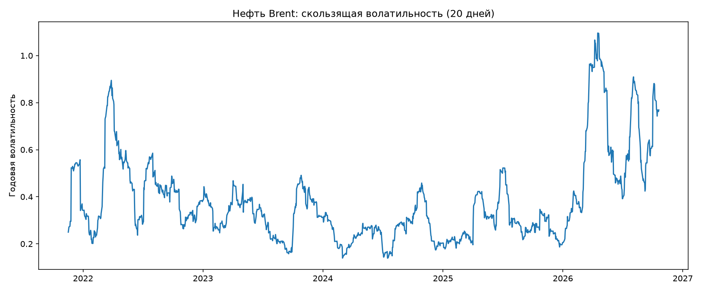
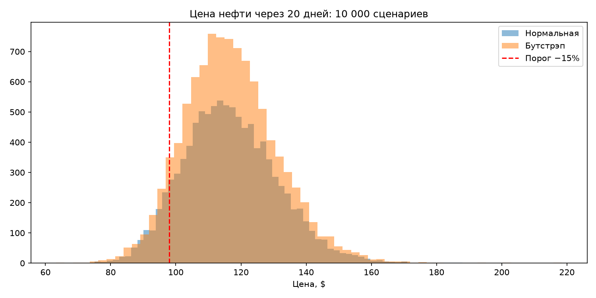
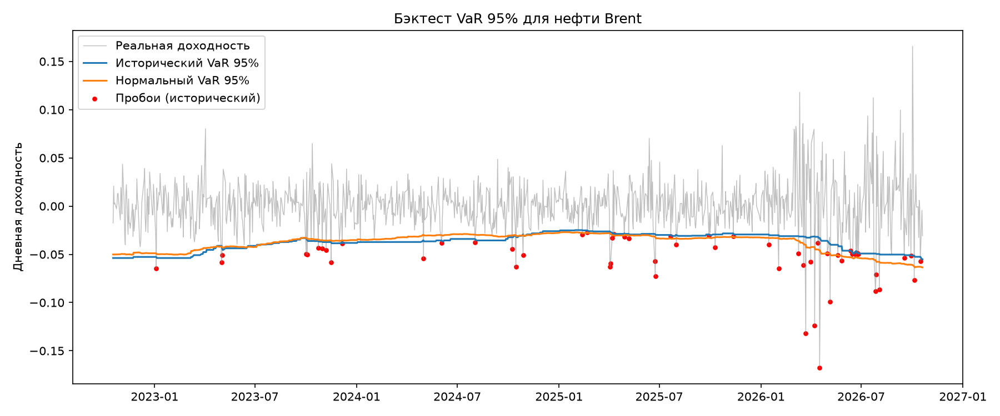
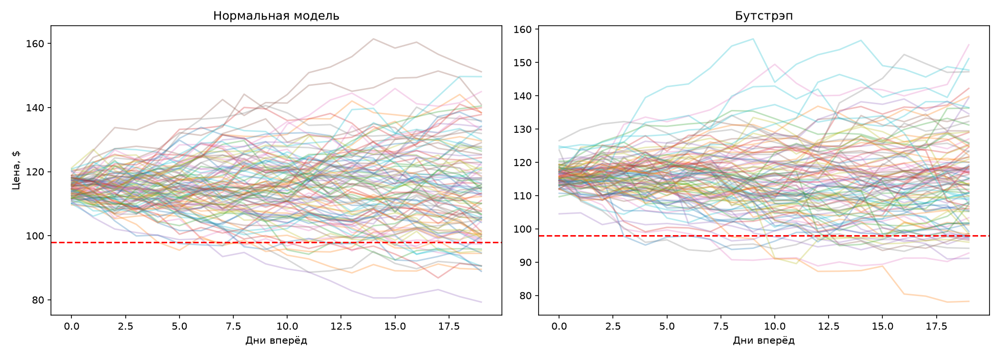

# Monte-Carlo
«Oil price risk: historical analysis, Monte Carlo and VaR backtest»
Анализ исторического риска для нефти марки Brent, моделирование методом Монте-Карло(нормальная модель в сравнении с бустрепом) и бэктестинг показателя VaR, реализация на языке Python с использованием библиотеки NumPy.
#Вопрос
Насколько рискованна нефть и какой объем риска упускает из виду простая стандартная модель?э
#Методы
1.Дневная логарифмическая доходность ,волатильность, VaR и CVaR(95%)
2.Monte Carlo, за 20 дней, 10000 сценариев
нормальная модель и исторический bootstrap
3.Бэктест 95% VaR с окном в 250 дней, сравнение исторического метода и метода на основе нормального распределения 
##Результаты 

